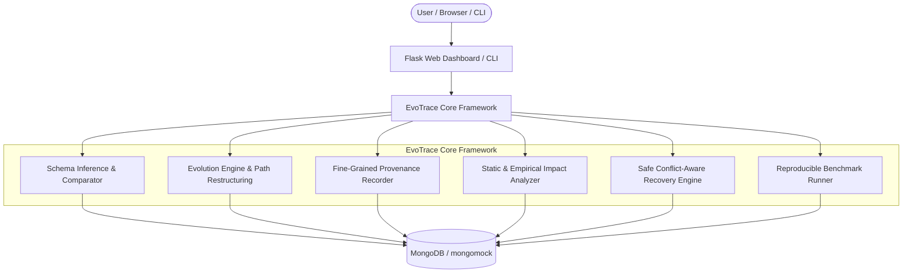

# NoSQL-EvoTrace

**A Provenance-Aware Framework for Impact Analysis and Recovery of Evolving NoSQL Documents**

NoSQL-EvoTrace is an academic research prototype designed for MongoDB-based document databases. It enables developers and database engineers to analyze observed document schemas, apply controlled schema evolution operations, record fine-grained provenance, analyze structural impacts on registered application queries, and safely recover supported transformations without destroying downstream modifications.

---

## 1. Key Features

- **Observed Schema Profiling:** Recursively infers hierarchical paths, observed BSON/Python data types, presence frequencies, explicit null counts, and missing counts. Computes deterministic SHA-256 schema fingerprints to compare snapshots across versions.
- **Controlled Evolution Operations:** Supports `add_field`, `delete_field`, `rename_field`, `move_field` (flat-to-nested and nested-to-flat), and safe, non-lossy `convert_type`. Detects structural parent collisions and rejects invalid mutations.
- **Fine-Grained Provenance:** Records append-only audit events capturing field-level before/after values, absence vs. explicit null distinction, and deterministic value fingerprints.
- **Query Impact Analysis:** Evaluates registered declarative MongoDB queries against schema mutations using static path intersection rules (exact, ancestor, descendant) and empirical result-count comparisons.
- **Conflict-Aware Recovery:** Synthesizes exact inverse operations from stored provenance. Compares current document states against recorded post-operation fingerprints; documents modified downstream are skipped to protect user edits.
- **Interactive Web Dashboard:** Clean, responsive UI built with Flask, semantic HTML, responsive CSS, and vanilla JavaScript (no Node.js or frontend build pipeline required).
- **Reproducible Evaluation Suite:** Generates controlled synthetic datasets ($N \in \{100, 500, 1000\}$), measures precision, recall, F1, query accuracy, recovery correctness, latency, and provenance overhead, and exports results to RFC-4180 CSV.

---

## 2. Architecture Overview



---

## 3. Technology Stack & Database Architecture

- **Python:** Python 3.11, 3.12, or 3.13
- **Framework:** Flask 3.x, Jinja2 templates, Semantic HTML5, CSS3, Vanilla JavaScript
- **Database Driver:** PyMongo 4.x
- **Primary Database Backend:** **MongoDB Community Server (Live)** (v6.0, 7.0, 8.0, 9.0+)
  - Default URI: `mongodb://127.0.0.1:27017/`
  - Dedicated Database: `nosql_evotrace`
  - All application documents and internal metadata collections (`evotrace_schema_snapshots`, `evotrace_evolution_operations`, `evotrace_provenance`, `evotrace_registered_queries`, `evotrace_experiment_results`) are maintained inside `nosql_evotrace`.
  - **No Silent Fallback:** `ALLOW_MOCK_FALLBACK` is strictly `false` by default. If MongoDB Community Server cannot be reached, the application reports a descriptive connection error instead of silently switching backends.
- **Testing Engine:** `mongomock`
  - Used **strictly for automated unit test isolation** (`pytest`) so that tests run reproducibly in CI or offline environments without altering live database records or requiring an active MongoDB daemon.
- **Deployment:** Docker & Docker Compose (optional containerized MongoDB environment)

---

## 4. Installation and Setup

### 4.1 MongoDB Community Server Installation & Windows Service

To run NoSQL-EvoTrace in live demonstration mode, ensure MongoDB Community Server is installed and running on `127.0.0.1:27017`.

1. **Install MongoDB Community Server on Windows:**
   - Download the official MSI installer from the [MongoDB Download Center](https://www.mongodb.com/try/download/community) (select Current Release, Windows x64).
   - Run the MSI installer and choose **"Complete"** installation.
   - Ensure the option **"Install MongoDB as a Service"** is checked (Service Name: `MongoDB`).
   - (Optional) Install MongoDB Compass for graphical collection inspection.

2. **Starting and Stopping the MongoDB Windows Service:**
   - **Start the service (PowerShell as Administrator):**
     ```powershell
     net start MongoDB
     # or: Start-Service MongoDB
     ```
   - **Verify MongoDB is listening on port 27017:**
     ```powershell
     Test-NetConnection -ComputerName 127.0.0.1 -Port 27017
     # Expected output: TcpTestSucceeded : True
     ```
   - **Stop the service (if needed):**
     ```powershell
     net stop MongoDB
     # or: Stop-Service MongoDB
     ```
   - **Via Windows Services Manager:**
     Press `Win + R`, type `services.msc`, locate **MongoDB Server (MongoDB)**, and ensure the status is **Running**.

### 4.2 Local Project Setup

1. **Open the workspace:**
   ```bash
   cd "F:\PROJS\NoSQL EvoTrace"
   ```

2. **Create and activate a virtual environment (optional but recommended):**
   ```bash
   python -m venv .venv
   # Windows PowerShell:
   .venv\Scripts\Activate.ps1
   # Linux/macOS:
   source .venv/bin/activate
   ```

3. **Install required dependencies:**
   ```bash
   pip install -r requirements.txt
   ```

4. **Configure environment settings:**
   Copy `.env.example` to `.env` (or set environment variables as needed):
   ```bash
   cp .env.example .env
   ```

   **Key Environment Variables:**
   | Variable | Default Value | Description |
   | :--- | :--- | :--- |
   | `MONGO_URI` | `mongodb://127.0.0.1:27017/` | Connection URI for MongoDB Community Server |
   | `MONGO_DB_NAME` | `nosql_evotrace` | Target database for all collections |
   | `ALLOW_MOCK_FALLBACK` | `false` | Must remain `false` for live MongoDB. If `false`, server fails clearly when MongoDB is offline |
   | `SECRET_KEY` | *(Auto-generated in dev)* | Cryptographically secure Flask session key; mandatory in `FLASK_ENV=production` |
   | `FLASK_DEBUG` | `0` | Debug mode (disabled by default; set to `1` for local live reloading) |
   | `HOST` / `PORT` | `127.0.0.1` / `5000` | Local web server bind address |

---

## 5. Running the Application

### 5.1 Check System Connectivity
Before launching the server, verify the live MongoDB connection via the CLI:
```bash
python cli.py status
```
**Expected Output:**
```
============================================================
NoSQL-EvoTrace System Status
============================================================
Connected:             True
Backend Type:          MongoDB Community Server (Live)
Database URI:          mongodb://127.0.0.1:27017/
Target Database:       nosql_evotrace
Server Version:        9.0.4
Native Transactions:   False
============================================================
```

### 5.2 Seed Demonstration Dataset
Populate the `demo_customers` collection and register initial sample queries in MongoDB Community Server:
```bash
python cli.py seed --collection demo_customers
```

### 5.3 Launch the Web Dashboard
Start the Flask application server:
```bash
python run.py
```
Open `http://127.0.0.1:5000/` in your browser. The top navigation bar and dashboard will display:
- **Status Pill:** `● MongoDB Community Server (Live)`
- **Database Runtime:** MongoDB Community Server version, URI, and database `nosql_evotrace`.
- If the MongoDB service is stopped, the dashboard displays a clear `● Disconnected` status and guidance banner without crashing or silently falling back.

### 5.2 Docker Compose Startup (When Docker is available)
To run the full stack with MongoDB and persistent volume storage:
```bash
docker-compose up --build -d
```
Access the dashboard at `http://localhost:5000/`.

To inspect logs:
```bash
docker-compose logs -f web
```

To stop containers:
```bash
docker-compose down
```

---

## 6. Command-Line Interface (CLI)

The `cli.py` utility provides administrative and evaluation commands:

- **Check connection status:**
  ```bash
  python cli.py status
  ```

- **Seed the demo dataset:**
  ```bash
  python cli.py seed --collection demo_customers
  ```

- **Inspect schema profile:**
  ```bash
  python cli.py inspect --collection demo_customers
  ```

- **Run reproducible benchmarks:**
  ```bash
  python cli.py benchmark --sizes 100,500,1000 --seed 42 --csv-out eval_results.csv
  ```

---

## 7. Running the Automated Test Suite

NoSQL-EvoTrace includes an automated test suite covering schema inference, nested paths, transformations, provenance, impact analysis, recovery conflict detection, seeder isolation, web routes, and MongoDB Community Server integration:

```bash
python -m pytest -v
```

> [!NOTE]
> Automated tests execute in an isolated in-memory `mongomock` sandbox by default (`FORCE_MOCK=True` in test fixtures), ensuring test runs do not alter live database records in `nosql_evotrace` or require an external database service. Dedicated integration tests in [`tests/test_mongo_integration.py`](tests/test_mongo_integration.py) verify live MongoDB Community Server ping/CRUD operations and explicitly verify that the application refuses to silently fall back to mongomock when MongoDB is unreachable.

**Verification Results:**
```
============================= test session starts =============================
platform win32 -- Python 3.13.2, pytest-9.1.1
collected 58 items

tests/test_benchmark.py ......................... [ 12%]
tests/test_config_security.py ................... [ 18%]
tests/test_evolution_operations.py .............. [ 27%]
tests/test_impact_analysis.py ................... [ 36%]
tests/test_mongo_integration.py ................. [ 43%]
tests/test_nested_paths.py ...................... [ 51%]
tests/test_provenance.py ........................ [ 58%]
tests/test_recovery_conflicts.py ................ [ 75%]
tests/test_schema_inference.py .................. [ 82%]
tests/test_seeder.py ............................ [ 87%]
tests/test_web_routes.py ........................ [100%]

============================= 58 passed in 14.61s =============================
```

---

## 8. Guided Demonstration Sequence

A complete 5–8 minute demonstration script is documented in [`docs/DEMO_SCRIPT.md`](docs/DEMO_SCRIPT.md):
1. **Overview & System Status:** Open `http://127.0.0.1:5000/` and verify connectivity.
2. **Seed Demonstration Data:** Click **🌱 Seed Demo Dataset** to populate `demo_customers` with 10 synthetic documents and 5 registered queries.
3. **Inspect Schema Profile:** View field frequencies, types, and the distinction between missing fields and explicit nulls.
4. **Query Registry:** Test live query execution on `{"postal_code": {"$exists": true}}`.
5. **Evolution Preview & Execution:** In **Evolution Workspace**, select `rename_field` (`postal_code` ➔ `zip_code`). Preview dry-run shows 10 affected docs and 1 affected query. Apply with confirmation.
6. **Provenance Explorer:** Inspect field-level pre/post states and SHA-256 value fingerprints.
7. **Safe Conflict-Aware Recovery:** Simulate a downstream edit on one document, inspect the Recovery Preview, observe that the conflicting document is skipped, and verify 9 compatible documents are cleanly restored.
8. **Reproducible Benchmarks:** Run the evaluation suite from **Experiments** and download the CSV report.

---

## 9. Documentation Directory

- [`docs/ARCHITECTURE.md`](docs/ARCHITECTURE.md): Architectural components, data flow, logical collections, and Mermaid diagrams.
- [`docs/ALGORITHMS.md`](docs/ALGORITHMS.md): Formal pseudocode for inference, path restructuring, safe evolution, impact analysis, recovery inversion, and metric equations.
- [`docs/RESEARCH_OVERVIEW.md`](docs/RESEARCH_OVERVIEW.md): Problem statement, research question, related work categories, and academic positioning.
- [`docs/EXPERIMENTS.md`](docs/EXPERIMENTS.md): Benchmark methodology, parameters, ground-truth formulations, and measured results table.
- [`docs/TEST_REPORT.md`](docs/TEST_REPORT.md): Complete test run output, pass/fail totals, and environment diagnostic status.
- [`docs/DEMO_SCRIPT.md`](docs/DEMO_SCRIPT.md): Detailed 5–8 minute demonstration walkthrough with expected observables.

---

## 10. Research Positioning & Honest Limitations

- **Academic Prototype:** This framework is an academic prototype for MongoDB document databases, not a universal migration engine for all NoSQL databases.
- **Query Registration Boundary:** Impact analysis evaluates registered declarative MongoDB queries. It does not perform general static AST analysis of external application source code.
- **Empirical Indicators:** Query result count changes indicate altered query behavior, not definitive proof of a bug; conversely, unchanged counts do not guarantee semantic equivalence.
- **Safe Type Conversion Scope:** Only safe, validated, non-lossy conversions are permitted. Lossy transformations (such as truncated floats to integers) are rejected.
