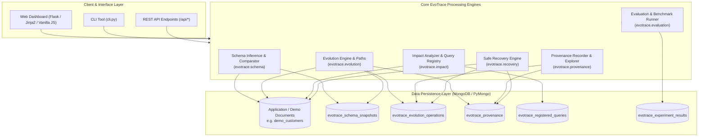

# NoSQL-EvoTrace: System Architecture

## 1. Overview
**NoSQL-EvoTrace** is a provenance-aware framework for document-level schema analysis, controlled schema evolution, transparent query impact assessment, and conflict-checked recovery for MongoDB databases.

---

## 2. Architectural Diagram

---

## 3. Component Breakdown

### 3.1 Schema Analysis Engine (`evotrace.schema`)
- **Inference (`inference.py`)**: Recursively traverses BSON documents, identifying observed hierarchical field paths (using dot notation), mapped BSON/Python data types, presence frequencies, explicit null counts, and missing counts.
- **Fingerprint Calculator**: Generates a deterministic, canonical SHA-256 hash summarizing the structural profile (paths, observed types, presence buckets) to enable rapid equality checks across versions.
- **Comparator (`comparator.py`)**: Computes structural differences between any two snapshots, detailing added fields, removed fields, type shifts, and presence ratio deltas.

### 3.2 Evolution Engine (`evotrace.evolution`)
- **Path Utilities (`paths.py`)**: Manages nested dot-path retrieval, insertion, and deletion. Detects parent-structure collisions (e.g. attempting to nest inside an existing primitive string).
- **Validation (`validation.py`)**: Enforces syntactic rules, restricts system collections, prevents modification of `_id`, and validates safe, non-lossy type conversions.
- **Engine (`engine.py`)**: Provides a dry-run preview before mutation, executes bulk changes with transaction support (where available) or a compensating rollback journal, and triggers before/after snapshots and provenance capture.

### 3.3 Fine-Grained Provenance Engine (`evotrace.provenance`)
- **Recorder (`recorder.py`)**: Persists append-only provenance documents detailing the exact previous and resulting states of each affected document. Preserves the crucial distinction between absent fields and explicit nulls.
- **Fingerprinting**: Computes deterministic hashes of field values prior to and following transformation, forming the basis for downstream conflict detection.
- **Explorer (`explorer.py`)**: Provides search, filtering, and privacy redaction for audit inspections.

### 3.4 Impact Analysis Engine (`evotrace.impact`)
- **Query Registry (`registry.py`)**: Stores declarative MongoDB query filters with explicit field-path dependencies. Rejects arbitrary executable scripts (e.g. `$where`).
- **Analyzer (`analyzer.py`)**: Combines static dependency intersection (checking exact, ancestor, and descendant path overlaps) with empirical execution comparison (measuring matching document count differences before and after transformation).
- **Reporter (`reporter.py`)**: Produces structured risk reports with actionable recommendations.

### 3.5 Safe Recovery Engine (`evotrace.recovery`)
- **Inversion Generator (`engine.py`)**: Dynamically constructs inverse operations from recorded pre-operation states.
- **Conflict Checker**: Validates that the current document state matches the post-operation fingerprint before executing a restoration. Documents modified by downstream user code are skipped to protect user edits.
- **Audit Logger (`audit.py`)**: Logs each recovery as an independent append-only provenance event, ensuring full idempotency and duplicate prevention.

### 3.6 Benchmark & Evaluation Runner (`evotrace.evaluation`)
- **Synthetic Generator (`generator.py`)**: Produces synthetic document collections of configurable sizes ($N \in \{100, 500, 1000, 5000\}$) with controlled variance and ground truth.
- **Benchmark Suite (`benchmark.py`)**: Measures precision, recall, F1, query impact accuracy, recovery correctness, latency, and provenance storage overhead.
- **Export (`export.py`)**: Formats results for CSV and JSON download.

---

## 4. Centralized Logical Collections

| Collection Name | Purpose | Key Attributes |
|---|---|---|
| `demo_customers` | Target application collection | Heterogeneous customer documents, nested address, tags |
| `evotrace_schema_snapshots` | Point-in-time schema profiles | `snapshot_id`, `schema_fingerprint`, `fields`, `created_at` |
| `evotrace_evolution_operations` | Catalog of requested mutations | `operation_id`, `operation_type`, `status`, `pre/post_version_ids` |
| `evotrace_provenance` | Granular audit trail | `provenance_id`, `affected_doc_ids`, `field_changes`, `is_recovery` |
| `evotrace_registered_queries` | Declared application queries | `query_id`, `name`, `filter_spec`, `referenced_paths`, `enabled` |
| `evotrace_experiment_results` | Reproducible benchmark metrics | `experiment_id`, `scenario_name`, `dataset_size`, `metrics` |

---

## 5. Failure Handling and Rollback Strategy
1. **Multi-Document Transactions**: When connected to a MongoDB replica set or sharded cluster, operations utilize native multi-document ACID transactions via PyMongo client sessions.
2. **Safe Operation Journal**: On standalone MongoDB deployments or embedded development environments where transactions are unsupported, EvoTrace records an in-memory journal of original document states prior to mutation. If any document update fails, a compensating rollback restores modified documents to their original state and marks the operation status as `FAILED`.
